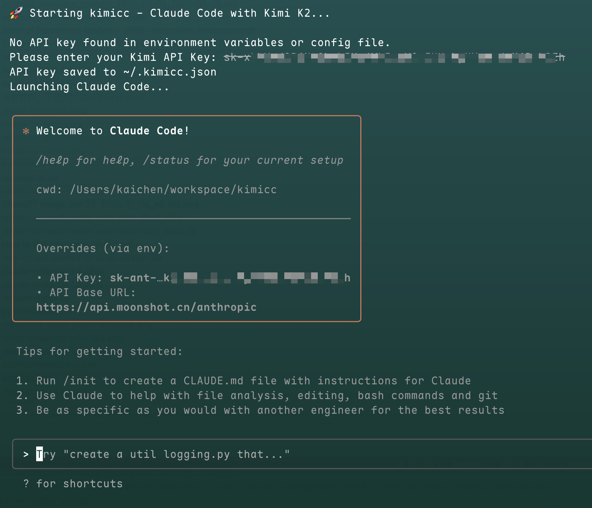

# KIMICC

[Read Chinese Instructions](README.zh.md)

One-step command `npx kimicc` to run Claude Code using Kimi K2 / GLM-4.6 / Qwen3-Coder / DeepSeek-v3.2.

一步命令 `npx kimicc` 使用  Kimi K2 / GLM-4.5 / Qwen3-Coder / DeepSeek-v3.1 运行 Claude Code。

Or install KimiCC with `npm install -g kimicc`.

This is a lightweight Node.js npm package that sets up environment variables at startup, allowing Claude Code to call Kimi K2 / GLM-4.6 / Qwen3-Coder / DeepSeek-v3.2 models.

这是一个轻量的 nodejs 的 npm 包，在启动时设置好环境变量，让 Claude Code 调用  Kimi K2 / GLM-4.6 / Qwen3-Coder / DeepSeek-v3.2 模型。

## Why use Kimi K2 / GLM-4.5 / Qwen3-Coder / DeepSeek-v3.1 to run Claude Code

1. Due to special reasons, Claude is difficult to subscribe to stably and has technical restrictions on certain regions;
2. Claude subscription prices are unaffordable and difficult to pay for the vast majority of people in developing countries;
3. Many large model vendors have launched Anthropic-compatible interfaces;
4. Several domestic Chinese large models have achieved high Agentic capabilities, sufficient to handle the Claude Code system;
5. API has no network issues, costs only 1/N of Claude's price, supports multiple payment methods;
6. Let more people experience the most advanced development tools and make vendors compete.
7. v2.0 added: Support for running multiple different APIs simultaneously, improving concurrent capabilities, such as allowing multiple Kimi accounts to run concurrently locally.

## What does this tool package do?

This tool does some small work to save you time handling configuration tasks. At the bottom layer, it sets up Auth Token and Base URL environment variable parameters before starting claude.

Compared to other tutorials that require you to configure files or add long parameters at startup, using this tool will save your valuable time and energy.

## Usage

### Get API Key

Here are the console addresses:
- [Kimi/Moonshot](https://platform.moonshot.cn/console/api-keys)
- [GLM/Zhipu](https://bigmodel.cn/usercenter/proj-mgmt/apikeys) [Supports 60 RMB monthly subscription](https://www.bigmodel.cn/claude-code?ic=FHME2QL1XG)
- [Qwen/AlibabaCloud](https://bailian.console.aliyun.com/?tab=globalset#/efm/api_key)
- [DeepSeek](https://platform.deepseek.com/api_keys)

### Configuration and Startup

- Step 1: Get API Key
- Step 2: With Node.js environment on your local machine, run `npx kimicc` to install and start, or use `npm install -g kimicc`;
- Step 3: After installation, you can use kimicc to start directly, and enter the Auth Token when prompted.

First initialization will prompt you to enter Auth Token, no need to set it again next time.

⚠️Note⚠️, when starting Claude Code will ask for AUTH TOKEN, default is NO(recommended), at this time select YES.

Do you want to use this auth token? SELECT YES!!!

How to uninstall: `npm uninstall kimicc`

Completely uninstall claude code: `npm uninstall @anthropic-ai/claude-code`

### Using models other than Kimi

By default, if no parameters are added, it starts with the kimi model configuration. Using the following parameters can start other models

- `--deepseek` will set base_url=https://api.deepseek.com/anthropic model=deepseek-chat
- `--glm` will set base_url=https://open.bigmodel.cn/api/anthropic model=glm-4.6
- `--qwen` will set base_url=https://dashscope.aliyuncs.com/api/v2/apps/claude-code-proxy model=qwen3-coder-plus

### Custom large model names

When starting or setting Profile, you can use the following parameters to set models,

- `--model` used to specify the main large model type.
- `--small-fast-model` used to specify the auxiliary fast small model, if not specified then use `--model` configuration.

This allows users to use the latest large model releases immediately. For example, when kimi releases kimi-k2-0905-preview, use the latest model via `kimicc --model=kimi-k2-0905-preview`.

### Additional command features

- `kimicc reset` Reset configuration.
- `kimicc inject` Persist Anthropic environment variables into `~/.claude/settings.json` (`env` block) so `claude` picks them up without running `kimicc`. Use `--profile`, `--base-url`, `--model`, or `--small-fast-model` to override values for the saved env.
- `kimicc inject --reset` Remove the managed environment keys (`ANTHROPIC_AUTH_TOKEN`, `ANTHROPIC_BASE_URL`, `ANTHROPIC_MODEL`, `ANTHROPIC_SMALL_FAST_MODEL`) from `~/.claude/settings.json`.
- `kimicc ping [options]` Send a minimal `/v1/messages` probe against each configured model to verify connectivity. Supports `--profile`, provider quick flags, `--model`, `--small-fast-model`, `--timeout`, `--json`, and `--verbose`.
- `kimicc profile` Support configuring multiple different service providers.

## Under the hood

Claude Code exposes some environment variables that can be used to configure model services, which are divided into three levels: haiku, sonnet, and opus.

- ANTHROPIC_BASE_URL Large model service interface address (this variable is no longer documented in official docs and may be removed at any time to prevent third-party model usage)
- ANTHROPIC_MODEL Fallback used when no detailed configuration below is provided
- ANTHROPIC_DEFAULT_HAIKU_MODEL Lightweight tasks
- ANTHROPIC_DEFAULT_SONNET_MODEL Main model
- ANTHROPIC_DEFAULT_OPUS_MODEL Highest intelligence model, or used to drive Plan mode

Note that ANTHROPIC_SMALL_FAST_MODEL has been deprecated.

As long as the above environment variables are set during claude code runtime, the models it uses can be modified, of course the service interface also needs to be consistent with anthropic.

There are several ways to modify environment variables:

1. Directly before the startup command line, in the form of KEY=value placed before the command line;
2. Write to the corresponding shell configuration file, such as bashrc, zshrc;
3. Write to the "env" section in the `.claude/settings.json` configuration.

Reference:
- https://docs.claude.com/en/docs/claude-code/model-config#environment-variables
- https://docs.claude.com/en/docs/claude-code/settings#environment-variables

## Version History

- v1.x Basic functionality implementation
- v2.x
  - v2.0.0 Support profile functionality, can start multiple configurations separately
  - v2.1.0 Default support for Kimi K2 / GLM-4.5 / Qwen3-Coder / DeepSeek-v3.1
  - v2.1.1 update glm-4.6 config

## Known Issues

- This project was first developed and tested on Mac, no guarantee for Linux and Windows systems, welcome to report issues and submit PRs.
- Due to Kimi K2 not supporting multimodal, cannot paste and read images.
- Kimi has restrictions on request frequency and daily request volume at different recharge levels, may need to recharge at least 50 yuan to reach a level that meets basic usage needs, check [official interface rate limit description](https://platform.moonshot.cn/docs/pricing/limits).
- Since this tool only modifies environment variables, it will make kimicc also write to Claude's data directory, sharing session and data statistics. The latest version v2.1.x will write corresponding model calls, and statistics will display different models separately.

👏 Welcome to raise issues or request more features.

## License

MIT. Kai<kai@thekaiway.com>
